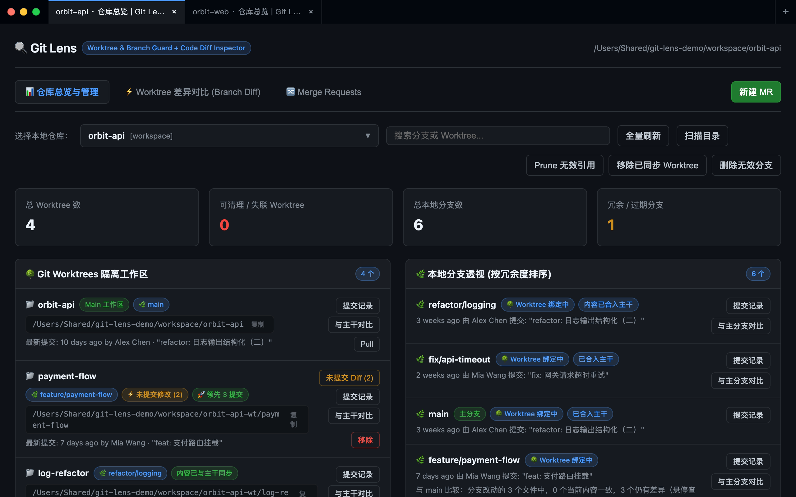
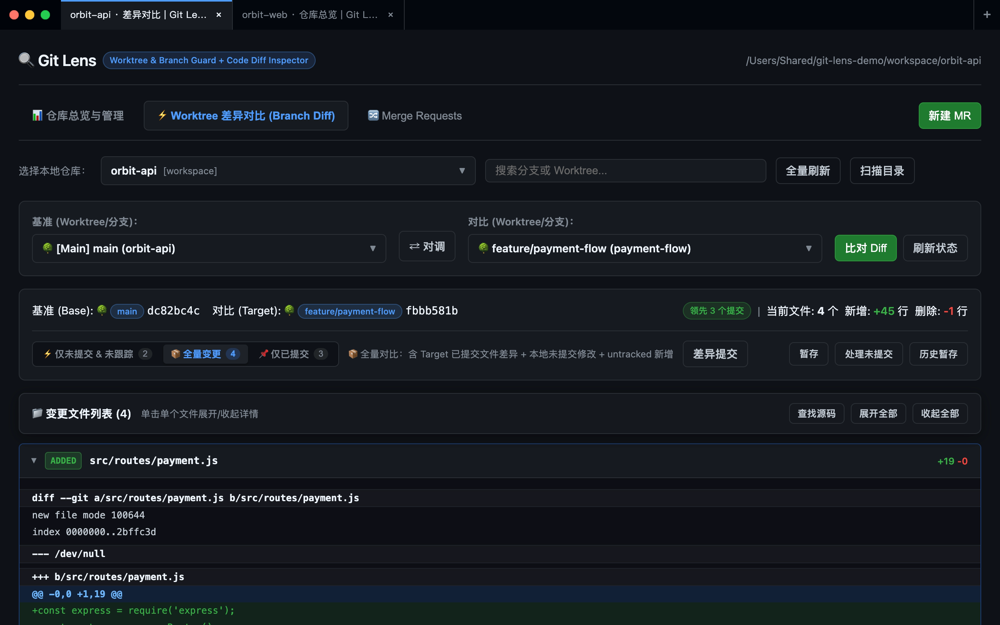
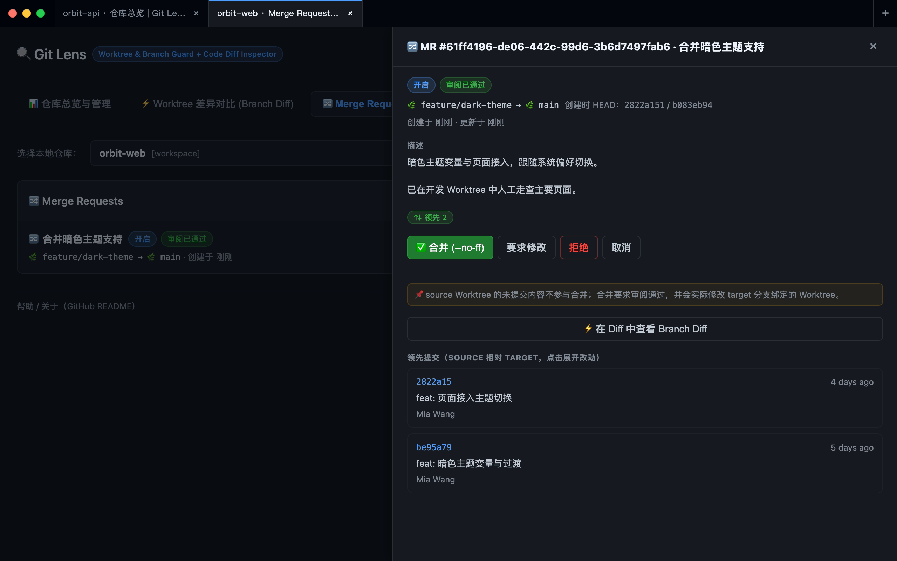

# Git Lens

**看清本地 Git 仓库的 Worktree、分支和代码差异。**

[](https://github.com/SharpXia/git-lens-web/releases)
[](./LICENSE)
[](https://github.com/SharpXia/git-lens-web/releases)

Git Lens 是一个 Electron 桌面应用：扫描你指定的 Workspace，集中查看仓库状态、Worktree、分支、提交和 Diff，再决定是否清理或执行本地 Git 操作。项目早期以浏览器页面形态交付，自 v1.0.0 起以桌面应用为主要形态发布，仓库名 `git-lens-web` 沿用至今。

[下载安装](#下载安装) · [功能概览](#功能概览) · [界面预览](#界面预览) · [分支安全判定](#分支安全判定) · [架构](#架构) · [使用指南](#使用指南) · [Roadmap](#roadmap)

> [!NOTE]
> 文档中的截图与动图由当前版本在临时虚构仓库中实际运行生成。图片里的仓库名、路径、提交、分支和用户均为演示数据，不对应任何真实项目。

## 为什么使用它

这个工具最初要解决的问题来自 AI 并行开发：当多个 agent 同时开工、每个任务各自创建 Worktree 和分支时，本地很快会堆出十几个工作区、几十条分支——哪些有未提交改动、哪些早已被合并或吸收、哪些可以安全删除，单靠命令行很难看清。人在多分支并行时尚且如此，AI 并行开发更是把这个问题放大了一整个数量级：

- 不容易快速判断哪个 Worktree 还有未提交改动；
- 分支已经被合并、被 Cherry-pick 吸收或只剩无效引用时，单看提交数量容易误判；
- 对比两个分支前，常常需要先创建 Worktree；
- 清理 Worktree、分支或未提交修改时，需要在多个 Git 命令之间切换。

Git Lens 把这些信息放进一个本地桌面窗口，先展示事实和 Diff，再提供有确认步骤的清理、Stash、Cherry-pick、Revert 和本地 MR 操作。

## 下载安装

### 安装包

1. 前往 [Releases](https://github.com/SharpXia/git-lens-web/releases) 下载最新版本；
2. 按芯片选择安装包：
   - Apple Silicon：`git-lens-web-<版本>-mac-arm64.dmg`
   - Intel：`git-lens-web-<版本>-mac-x64.dmg`
3. 打开 dmg，将应用拖入「应用程序」。

安装包已完成 Developer ID 签名并通过 Apple 公证，可直接打开。

### 校验下载文件

每个 Release 附带 `SHA256SUMS.txt`。下载后与本机计算的哈希比对：

```bash
shasum -a 256 git-lens-web-1.1.4-mac-arm64.dmg
```

输出与 `SHA256SUMS.txt` 中对应行一致即可。

### 自动更新

应用内置更新检查：发布新版本后，应用内会收到提示并完成更新，无需重新下载安装包。

### 平台支持

当前提供 macOS 安装包（Apple Silicon / Intel）。Windows 与 Linux 打包在计划中，见 [Roadmap](#roadmap)。

### 从源码运行

环境要求：`git` 可以在终端直接调用；已安装 pnpm 11（推荐通过 `corepack enable` 启用）；Node.js 版本满足 `^20.19.0 || >=22.12.0`。

```bash
git clone https://github.com/SharpXia/git-lens-web
cd git-lens-web
pnpm install --frozen-lockfile
pnpm exec electron electron/main.js
```

仓库同时保留浏览器形态的本地服务入口：`pnpm start` 后访问 [http://127.0.0.1:9527](http://127.0.0.1:9527)，服务只监听本机回环地址。

## 功能概览

| 模块 | 当前能力 |
| --- | --- |
| 📁 扫描目录 | 添加多个 Workspace 并持久化；检查目录本身和直接子目录中的 Git 仓库；支持系统目录选择器和手动输入路径。 |
| 📊 仓库总览 | 展示 Worktree、分支、失联引用和可清理项；支持仓库搜索、收藏和星标筛选。 |
| 🌳 Worktree 管理 | 区分主工作区和派生 Worktree，显示目录状态、未提交文件、领先提交和绑定分支；支持移除 Worktree、Prune 无效引用和批量清理；支持在指定目录基于已有或新建分支创建 Worktree；编辑工作区名称会同步重命名根目录（主工作区仅改显示名），并支持直接上锁/解锁（上锁后 git 拒绝移除与清理）。 |
| 🌿 分支管理 | 左右分栏同时管理本地与远端分支：本地分支支持检出到任选工作区，未检出分支可删除（未合入主干需二次确认强制删除）；远端分支支持清单与同步状态、基于现有分支直接创建新远端分支（纯远端操作）、检出（可重命名）、合并到当前工作区（冲突支持按侧快捷采用或自定义编辑冲突区域）、删除非保护分支（远端默认分支为保护分支不可删）；支持手动/自动定时 fetch，合并前久未刷新会提醒先 fetch。 |
| 🌿 分支透视 | 展示主分支、Worktree 占用、已合入、内容已被吸收和过期分支；支持普通删除或强制删除。 |
| ⚡ Branch Diff | Base 和 Target 可分别选择 Worktree 或本地分支，支持 Worktree ↔ Worktree、分支 ↔ 分支以及混合比较；支持 `⌘F` 源码查找（跨文件、折叠文件与长行定位）；变更文件按源码、文档、资源分类，再按后缀与 Added → Modified → Deleted → Untracked 排序。 |
| 🧹 未提交自审 | 选择同一个 Worktree 时进入自审模式，查看未提交和未跟踪文件；支持 Stash、Pop、Drop 和丢弃全部修改。 |
| 🔀 本地 MR | 对两个本地分支创建 Merge Request，经过通过、要求修改或拒绝后再执行 `git merge --no-ff`；冲突会自动中止并保留 MR。 |
| 📋 提交记录 | 查看分支相对主干的领先/落后，按作者、关键词和日期过滤，按日期分组浏览，并展开提交详情和单提交 Diff。 |
| 🍒 提交操作 | 对当前分支执行 Cherry-pick 或 Revert；冲突、空提交和不合法目标会返回中文错误，并自动恢复现场。 |
| 🗂 多标签工作区 | 每个仓库一个标签；标签支持拖拽排序与插入位置提示，`⌘1`–`⌘9` / `⌘0` 按位置切换，标签顺序在重启后保持。 |

## 界面预览

下面的动图来自一组虚构 fixture，依次展示仓库总览、Branch Diff、提交记录、未提交自审和本地 MR。它是当前版本桌面窗口的实际渲染结果，用来快速了解主要操作路径。

<p align="center">
  
</p>

仓库总览：左侧是 Worktree 状态（未提交修改、领先提交、内容已与主干同步），右侧是分支判定结果（已合入主干 / 内容已含入主干 / 冗余分支）。

<p align="center">
  
</p>

Branch Diff：基准与对比可分别选择 Worktree 或分支，变更文件分类展示，逐文件展开代码差异。

<p align="center">
  
</p>

本地 MR：审阅通过后才能合并，冲突会自动中止并保留 MR 记录。

<p align="center">
  
</p>

## 分支安全判定

删除分支前最关键的问题是：这个分支的改动是否已经以某种形式进入主干。仅凭 ahead/behind 计数会误判——被 merge、被 Cherry-pick 吸收或被 squash 压缩的分支，在提交计数上都是「领先」的。

Git Lens 在 `src/git-inspector.js` 中按四层递进判定，逐层收窄：

```text
分支相对 main 领先 N 个提交
        │
        ▼
① merge-base --is-ancestor ── 分支已是 main 的祖先 ────────────────→ 已合入主干
        │ 否
        ▼
② tree hash 比对 ── 分支末端树与 main 完全一致 ────────────────────→ 内容已吸收
        │ 否
        ▼
③ 补丁等价（git cherry）── 分支全部提交的补丁都已在 main ──────────→ 内容已吸收
        │            （覆盖 Cherry-pick / Revert 场景）
        ▼
④ merge-tree 模拟三方合并 ── 模拟合并无冲突且结果树与 main 一致 ────→ 内容已吸收
                     （覆盖 squash 与协调分支场景）
        │ 否
        ▼
保持「领先 N」判定，不给出可安全删除的结论
```

四层中任意一层命中即认为分支内容已进入主干，分支面板会给出对应的判定徽章与清理建议。判定思路的完整推导见博文：<https://xxdupup.top/posts/branch-safety-beyond-ahead-behind/>

## 架构

```text
┌────────────────────────────────────────────────────┐
│ Electron 主进程                                     │
│   窗口与融合标题栏 · 标签条 · 更新检查                │
│   内置本地服务子进程（127.0.0.1 随机端口 + 会话凭据）  │
└──────────────────────┬─────────────────────────────┘
                       │ 每个仓库标签一个 WebContentsView
┌──────────────────────▼─────────────────────────────┐
│ 渲染层（原生 HTML / CSS / JavaScript）               │
│   仓库总览 · Branch Diff · 本地 MR · 提交记录         │
└──────────────────────┬─────────────────────────────┘
                       │ HTTP（仅环回 + 会话凭据）
┌──────────────────────▼─────────────────────────────┐
│ Git Lens 服务（Express）                             │
│   仓库发现 · 状态分析 · Diff · MR 状态机              │
│   经 git CLI 读取和修改本地仓库                       │
└────────────────────────────────────────────────────┘
```

本地服务由应用统一启动和退出，只监听 `127.0.0.1`，API 请求需携带主进程注入的会话凭据。仓库内容不经过任何远程服务，全部操作都发生在本机。

## 使用指南

### 1. 配置扫描目录

首次打开应用时，点击「扫描目录」，使用系统目录选择器或手动输入添加一个或多个 Workspace。

每个扫描目录按以下规则处理：

1. 如果目录本身是 Git 仓库，直接加入仓库列表；
2. 如果目录本身不是 Git 仓库，只检查它的直接子目录；
3. 不会递归扫描更深层级；
4. 不存在、不可读或不是目录的路径会被拒绝保存。

### 2. 选择仓库

顶部仓库选择器支持：

- 按仓库名或路径模糊搜索；
- 将常用仓库加入星标；
- 只看星标仓库；
- 使用方向键和 Enter 选择。

重新打开应用后，各标签会恢复上次的仓库与页面状态。

### 3. 查看仓库状态

在「仓库总览与管理」中重点关注：

- Worktree 是否存在于磁盘；
- Worktree 是否有未提交或未跟踪文件；
- 分支是否被 Worktree 占用；
- 分支是否已经合入、被内容吸收或长期未活动；
- 是否存在失联 Worktree 引用和可安全清理项。

领先徽章会结合祖先关系、树一致、补丁等价和 `merge-tree` 判定，避免把已经通过 Cherry-pick、Revert 或 squash 吸收的内容继续当成独有改动。判定细节见[分支安全判定](#分支安全判定)。

### 4. 审查 Diff

可以从 Worktree 或分支行进入 Diff，也可以直接打开「Worktree 差异对比 (Branch Diff)」：

- **仅未提交 & 未跟踪**：只看工作区当前修改；
- **全量变更**：同时看提交内容和未提交修改；
- **仅已提交**：只比较引用中的已提交内容；
- **同一 Worktree**：自动进入未提交自审模式；
- **分支 ↔ 分支**：不读取任何 Worktree 的脏数据；
- **图片和二进制文件**：按文件类型展示，不把二进制内容当作普通文本 Diff；
- **源码查找**：`⌘F` 在差异中定位内容，支持跨文件、折叠文件与长行。

### 5. 使用本地 MR

创建本地 MR 后按以下流程操作：

1. 选择源分支和目标分支；
2. 填写标题和描述；
3. 审阅通过、要求修改或拒绝；
4. 只有审阅通过后才能合并；
5. 合并使用 `git merge --no-ff`，成功后记录合并提交；
6. 目标 Worktree 不干净或发生冲突时，服务会自动中止合并并保留 MR。

### 6. 管理提交和未提交修改

从 Worktree 或分支行打开「提交记录」：

- 按作者、关键词、开始日期和结束日期过滤；
- 按日期分组查看提交；
- 展开完整提交正文、父提交和文件统计；
- 查看单提交逐文件 Diff；
- 将提交 Cherry-pick 到指定目标 Worktree；
- Revert 当前分支上的提交；
- 对未提交修改执行 Stash、Pop、Drop 或丢弃全部修改。

所有会修改 Git 仓库的操作都有二次确认。操作失败时会返回明确错误；Cherry-pick、Revert 和 MR 合并会尽量自动中止，避免仓库残留冲突状态。

### 7. 清理 Worktree 和分支

确认 Diff 和提交内容后，再执行清理：

- 「Prune 无效引用」对应 `git worktree prune`；
- Worktree「移除」对应 `git worktree remove`；
- 可选择同步删除仍与 Worktree 强绑定的分支；
- 分支删除前会再次校验绑定关系和当前状态；
- 批量清理只处理符合安全条件的候选项。

> [!CAUTION]
> 清理、Stash、丢弃修改、Cherry-pick、Revert 和本地 MR 合并都会修改本地 Git 仓库。执行前请核对目标路径、分支和需要保留的提交。未合并分支的删除可能使用强制删除。

## 配置与数据

默认配置文件：

```text
~/.config/git-lens-web/config.json
```

可以用环境变量覆盖配置目录：

```bash
GIT_LENS_CONFIG_DIR=/tmp/git-lens-web-dev-9528
```

配置文件只保存扫描目录列表。仓库状态、提交、分支和 Diff 都在请求时直接从本地 Git 仓库读取。

本地 MR 的记录也保存于配置目录下，按仓库路径归一化后分开存储。应用不会把仓库内容上传到远程服务。

## Roadmap

- Windows 安装包与自动更新适配；
- Linux 打包。

以上为方向性计划，暂无时间表。

## 项目结构

```text
electron/main.js        Electron 主进程：窗口、标签条、内置服务与更新检查
electron/…              标签条页面、窗口 chrome、服务配置与用户数据迁移等支撑模块
public/index.html       渲染层界面、样式与交互
src/server.js           服务入口（浏览器形态）
src/git-lens-server.js  本地 HTTP 服务、仓库发现与 API 路由
src/git-inspector.js    Git 状态分析、分支判定、Diff、提交和清理操作
src/merge-request-service.js
                        本地 MR 状态机和 Git 合并流程
src/merge-request-store.js
                        本地 MR 持久化
scripts/qa/             桌面与浏览器形态的隔离 E2E 测试
test/                   Git 状态、Diff、MR、Stash 和清理测试
docs/images/            README 界面截图与流程动图
```

渲染层使用原生 HTML、CSS 和 JavaScript，无需前端构建产物；服务通过 git CLI 读取和修改本地仓库。

## 验证

运行仓库测试：

```bash
# 首次运行时安装图片预览回归测试使用的浏览器
pnpm exec playwright install chromium
node --test

# 桌面端隔离 E2E（qa-root、配置与用户数据全部独立）
pnpm run test:desktop:isolated
pnpm run test:desktop:full
```

桌面自动化默认以隐藏窗口在后台运行，不抢占焦点。系统全屏等会切换 macOS Space、占满屏幕的侵入式用例默认跳过，只在发版前等关键阶段显式开启（全屏往返需要真实前台窗口，需叠加 `GIT_LENS_E2E_FOREGROUND=1`）：

```bash
GIT_LENS_E2E_INTRUSIVE=1 GIT_LENS_E2E_FOREGROUND=1 node --test test/tab-reorder.test.mjs
GIT_LENS_E2E_INTRUSIVE=1 GIT_LENS_E2E_FOREGROUND=1 pnpm run test:desktop:full
```

集成验证脚本需要先启动隔离服务，并将测试配置目录指向同一份 `GIT_LENS_CONFIG_DIR`。具体命令和 fixture 构建方式见：

- [本地 MR 与 Branch Diff 验证说明](./docs/local-mr-branch-diff.md)
- [Worktree 提交记录入口方案](./docs/design-worktree-commit-history-entry.md)

## 许可证

本项目以 [Apache License 2.0](./LICENSE) 发布。
